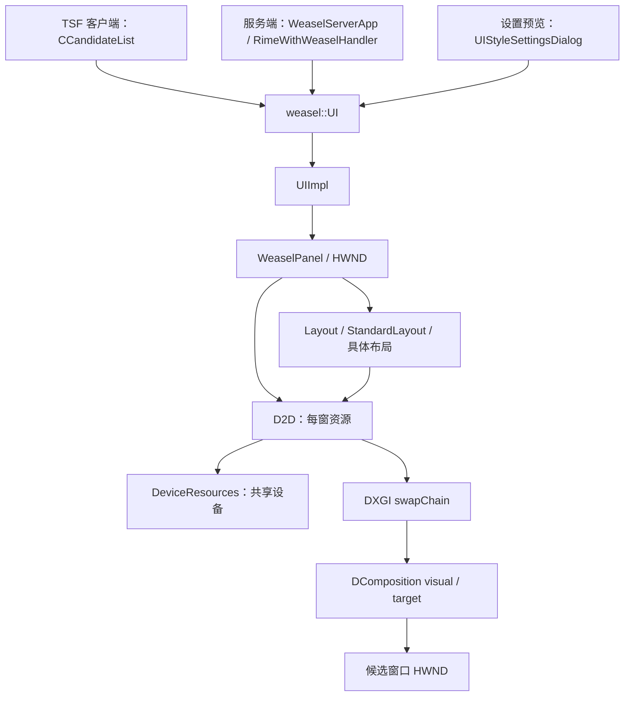

# WeaselUI 架构与个人 fork 的改造边界

## 阅读基线与阶段范围

核对日期：2026-10-14（Asia/Shanghai）。本文依据实际源码、工程文件和构建日志，行号均以该基线为准。

- upstream：[`rime/weasel`](https://github.com/rime/weasel)。本次获取时 master 为 [`4aea1978a351e2ce41af20c8fb88a01ce9802de8`](https://github.com/rime/weasel/commit/4aea1978a351e2ce41af20c8fb88a01ce9802de8)。
- DirectComposition 重构：2026-10-09 合并的 [PR #1927](https://github.com/rime/weasel/pull/1927)，合并提交 [`3a51afe2ff3f93123ba46b4a388fb74c043396af`](https://github.com/rime/weasel/commit/3a51afe2ff3f93123ba46b4a388fb74c043396af)。
- 已包含之后的 context 引用优化、尺寸和图标缓存优化，以及 2026-10-12 的 HWND 重建后尺寸缓存失效修复 `aeadcf801c4beea63d3f73aa05cf11deef311980`。
- `librime` gitlink 为 `1c23358157934bd6e6d6981f0c0164f05393b497`（1.13.1）；`plum` 为 `cab9ed35289f2022b6888503750d2dfb1851dbe0`。包括 leveldb 的嵌套依赖在内，已递归初始化并核对版本。
- 本阶段只新增构建基础设施和文档。没有修改 C++、输入逻辑、IPC 格式、TSF 接口或 UI 默认行为。构建证据和用户数据保护见 [build-baseline.md](build-baseline.md)。

**当前实现是 Direct2D/DirectWrite 绘制整窗交换链，再由 DirectComposition 合成。不是旧的 GDI+/分层窗口绘制，也不是每个候选项一个 DirectComposition visual。** 重构已删除 `DirectWriteResources.cpp`、`GdiplusBlur.*` 和 WeaselUI 的旧 `stdafx.*`；不能沿用旧文件上的改造方案。

## 重要文件与职责

| 文件 | 类 / 函数 | 职责 |
| --- | --- | --- |
| [include/WeaselUI.h](../include/WeaselUI.h) | `weasel::UI`、`UICallbackFunc` | 公共 UI 门面，维护 Context、Status、UIStyle 和回调 |
| [WeaselUI/WeaselUI.cpp](../WeaselUI/WeaselUI.cpp) | `UIImpl`、`UI::Create/Update/Refresh/Destroy` | PImpl 转发、内容去重、UI 对象生命周期 |
| [WeaselUI/WeaselPanel.h](../WeaselUI/WeaselPanel.h) / [.cpp](../WeaselUI/WeaselPanel.cpp) | `WeaselPanel` | HWND、消息分发、布局选择、绘制、定位、鼠标交互、定时器 |
| [WeaselUI/d2d.h](../WeaselUI/d2d.h) / [.cpp](../WeaselUI/d2d.cpp) | `DeviceResources`、`D2D` | 共享设备、每窗交换链 / visual / DC、字体、文字测量、路径和模糊阴影 |
| [WeaselUI/Layout.h](../WeaselUI/Layout.h) / [.cpp](../WeaselUI/Layout.cpp) | `Layout` | 布局接口、Context 引用、样式缩放副本、阴影和边框留白 |
| [WeaselUI/StandardLayout.h](../WeaselUI/StandardLayout.h) / [.cpp](../WeaselUI/StandardLayout.cpp) | `StandardLayout` | 文本尺寸、预编辑分段矩形、候选矩形、圆角规则、图标和翻页标记 |
| [WeaselUI/VerticalLayout.cpp](../WeaselUI/VerticalLayout.cpp) | `VerticalLayout::DoLayout` | 文字横排、候选逐行排列 |
| [WeaselUI/HorizontalLayout.cpp](../WeaselUI/HorizontalLayout.cpp) | `HorizontalLayout::DoLayout` | 候选横向排列，可按 max_width 换行 |
| [WeaselUI/VHorizontalLayout.cpp](../WeaselUI/VHorizontalLayout.cpp) | `VHorizontalLayout::DoLayout/DoLayoutWithWrap` | 文字竖排、左右列方向、按 max_height 换列 |
| [WeaselUI/FullScreenLayout.cpp](../WeaselUI/FullScreenLayout.cpp) | `FullScreenLayout::DoLayout/AdjustFontPoint` | 包装普通布局，调整字号并在监视器工作区居中 |
| [include/WeaselIPCData.h](../include/WeaselIPCData.h) | `Context`、`Status`、`UIStyle`、Boost `serialize` | 跨模块共享的数据和样式；修改有 IPC 兼容影响 |
| [include/WeaselStyleKeys.h](../include/WeaselStyleKeys.h) | `GetStyleKeys` | 设置界面可编辑样式键的元数据；不是独立的 UI 配置解析器 |
| [include/WeaselStyleColor.h](../include/WeaselStyleColor.h) | 样式颜色辅助代码 | 配色解析与共享样式支持 |
| [RimeWithWeasel/RimeWithWeasel.cpp](../RimeWithWeasel/RimeWithWeasel.cpp) | `LoadWeaselUIStyle`、`_UpdateUIStyle`、`_UpdateUIStyleColor`、`_UpdateUI`、`_ShowMessage` | Rime 配置 / 会话到 UI 和 IPC 的桥接；仅阅读边界 |
| [WeaselTSF/CandidateList.cpp](../WeaselTSF/CandidateList.cpp) | `CCandidateList` | TSF UIElement 生命周期、UI owner、客户端 Context 和回调；仅阅读边界 |
| [WeaselServer/WeaselServerApp.cpp](../WeaselServer/WeaselServerApp.cpp) | `WeaselServerApp::Run` | 服务端 UI 和 Rime handler 的装配 |
| [WeaselDeployer/UIStyleSettingsDialog.cpp](../WeaselDeployer/UIStyleSettingsDialog.cpp) | 预览 UI 创建 / 更新 | 复用同一个 WeaselUI 的样式预览窗口 |

## 入口与进程边界

`WeaselUI.vcxproj` 产出静态库 `WeaselUI.lib`，并以 C++17、Unicode、Release `/MT` 构建；最终链接到 TSF DLL、WeaselServer 和 WeaselDeployer。因此只改 WeaselUI 也需要重新构建这些使用方。



正常输入的候选窗重要入口是 **宿主进程内的 TSF UI**：待刷新的 Context 经 `Composition.cpp::_SetCompositionPosition` 更新插入点后，由 `_FlushPendingUI` → `WeaselTSF::_UpdateUI` → `CCandidateList::UpdateUI` → `UI::Update`。`StartUI` 调用 `ITfUIElementMgr::BeginUIElement`，尊重返回的 `_pbShow`；宿主要求自行呈现候选时，不应强制显示自定义窗。`_MakeUIWindow` 通过 `_GetActiveWnd` 选择 owner，保留 UWP / 活动视图的兼容要求。

服务端 `WeaselServerApp::Run` 先 `m_ui.Create(m_server.GetHWnd())`，再初始化 Rime handler；`InServer` 状态用于区别提示行为。`RimeWithWeaselHandler::_UpdateUI/_ShowMessage` 向这个 UI 提供切换模式、部署等提示，常用 `ShowWithTimeout`。不要把服务端提示窗当成唯一的候选窗实现位置。

设置界面调用 `Create(dialog_hwnd, true)`；预览窗可以拖动，不抢输入焦点，鼠标操作不会选择真实候选或翻页。以上三个入口共享实现，但 owner、显示策略和回调语义各不相同。

## 候选窗口生命周期

关键实现：`WeaselUI.cpp:39` 起的 `UI` 方法；`WeaselPanel.cpp:77` 构造、`:349 Create`、`:934 OnDestroy`。

1. `UI` 创建时没有 HWND。首次 `UI::Create` 分配 `UIImpl`，其成员 `WeaselPanel` 引用 UI 内的 Context、Status、style、ostyle 和 callback。
2. `WeaselPanel` 构造时分配 `shared_ptr<D2D>`，提前准备共享设备，加载状态图标。`D2D` 可以早于窗口存在。
3. `WeaselPanel::Create` 注册 `WeaselPanel` Win32 窗口类，在临时 Per Monitor V2 线程 DPI 上下文中创建 `WS_POPUP | WS_CLIPSIBLINGS` 窗口。扩展样式包括 `WS_EX_TOOLWINDOW | WS_EX_NOACTIVATE | WS_EX_NOREDIRECTIONBITMAP`；普通窗增加 `WS_EX_TOPMOST`，预览窗不增加。
4. `WM_NCCREATE` 将 this 写入 `GWLP_USERDATA`；静态 `WindowProc` 再转发到实例 `MsgHandler`。创建成功后 `AttachWindow` 绑定每窗渲染资源，准备字体。
5. `UI::Update` 先比较 Context 和 Status，相等即返回；改变时复制到自身并可按既有 `candidate_abbreviate_length` 缩略显示文字，再 `Refresh`。只改样式的调用方需要主动 `Refresh`，不能依赖相同 Context 触发更新。
6. TSF 和 server 现有路径会预热 `Refresh` 后隐藏窗口，降低首次显示成本。普通 `Hide` 使用 `SW_HIDE`，**保留图形资源**。
7. `Destroy(false)` 销毁 HWND，调用 `ReleaseWindowResources`，但保留 `UIImpl` / `D2D` 等可复用对象。之后 `Create` 可重新创建 HWND。
8. `Destroy(true)` 进一步 `ReleaseAllResources`、重置共享设备和 PImpl。UI 析构也走完整释放路径。

`OnDestroy` 清理定时器、拖动捕获、layout、hover/sticky 状态，并把 `m_lastWindowWidth/Height` 设回 -1。这是 10 月 12 日修复的关键：新 HWND 起始只有 10×10，不能根据旧窗缓存跳过 resize。当前 `_ResizeWindow` 还同时核对实际 client rect 和 swapChain 是否存在。

## Refresh 与每帧绘制的调用关系

```text
UI::Update(ctx, status) / UI::Refresh()
  UIImpl::Refresh()
    WeaselPanel::Refresh()
      D2D::AttachWindow()                   同窗也更新 DPI
      D2D::InitDirectWriteResources()        样式变化或字体缺失
      _UpdateHideCandidates()
      GetDeviceRemovedReason() / 必要时重建
      _CreateLayout() -> layout->DoLayout()
      _ResizeWindow() -> D2D::OnResize()
      _Reposition() / RepositionPreview()
      InvalidateRect()
        WM_PAINT -> DoPaint()
          BeginDraw -> Clear(透明)
          背景 -> preedit -> aux -> candidates -> 状态图标
          EndDraw -> swapChain->Present(1, 0)
```

刷新布局与绘制不是同一件事：`MoveTo` 通常只移动窗口；`Refresh` 每次重新创建 layout 并测量；`WM_PAINT` 使用布局结果绘制。后续动画不应为每个显示帧重复调用 Rime / IPC 或重新计算完整布局。

## DirectComposition / Direct2D / DirectWrite 资源

### 共享设备

`d2d.cpp:25 DeviceResources::Get` 返回函数静态单例，`:32 EnsureInitialized` 懒初始化。这里的共享范围是同一最终模块内的 UI 实例；它不是跨进程共享，也不能假设 TSF DLL、Server EXE 和 Deployer EXE 共用一个设备。

初始化顺序：D3D11 设备 → `IDXGIDevice` → `IDXGIFactory2` → `ID2D1Factory2` → `ID2D1Device1` → `IDCompositionDevice` → `IDWriteFactory2` → WIC 工厂。D3D11 **优先 WARP 软件设备**，失败才退到硬件，以避免常规情况下加载宿主进程的显卡驱动。D2D 工厂使用单线程模式；WIC 依赖调用线程已有 COM 初始化。新增 UI 预览 / 测试宿主必须安排 COM 初始化。

`DeviceResources::Reset` 释放上述单例持有的 COM 指针并清除 initialized 标志。每个 `D2D` 还持有设备指针副本，Reset 不会自动遍历并更新所有活跃窗。

### 每窗资源

`D2D::AttachWindow` / `InitDirect2D`（`:135` / `:155`）采用共享设备，然后创建当前窗口自己的资源：

```text
D2D device -> ID2D1DeviceContext
DXGI factory -> CreateSwapChainForComposition
  BGRA8 / premultiplied alpha / 2 buffers / FLIP_SEQUENTIAL
  back buffer IDXGISurface2 -> ID2D1Bitmap1 -> dc->SetTarget(bitmap)
DComposition device -> CreateTargetForHwnd(hwnd)
  target->SetRoot(visual)
  visual->SetContent(swapChain)
  device->Commit()
```

画刷 `ID2D1SolidColorBrush` 由当前 DC 创建并复用。图标通过 WIC 转成 PBGRA 位图，`GetCachedBmpFromIcon` 只缓存最近一个 HICON 对应的设备相关位图；重建渲染器时清掉。

`OnResize`（`:269`）先解除 DC target，释放 bitmap / surface，再 `ResizeBuffers`，重新获取后缓冲和 bitmap，绑定 visual / target 并 Commit。零尺寸跳过；Panel 用尺寸缓存避免无意义的 resize。

| 操作 | 实际释放行为 |
| --- | --- |
| `ShowWindow(SW_HIDE)` | 只隐藏，保留每窗和共享资源 |
| `ReleaseWindowResources` | DC SetTarget(nullptr)，释放 bitmap、surface、visual、target、swapChain，清空渲染器 HWND；没有释放 dc、brush、字体或所有设备副本 |
| `InitDirect2D` | 重新采用共享设备并创建每窗 DC、交换链和合成树；清除图标缓存 |
| `ReleaseAllResources` | 释放每窗资源，Reset 共享单例，再销毁当前 D2D |
| `D2D` 析构 | 释放成员 COM 指针和字体缓存；其余 ComPtr 成员也由析构自动释放 |

`d2d.h` 中提到 `keepResourcesOnHide` 的注释没有对应字段或开关；应以实现为准，不要把这个注释当成已有可配置能力。

### 字体和文本缓存

`InitDirectWriteResources` → `InitFontFormats` → `GetOrCreateTextFormat`（`:472` / `:438` / `:342`）。分别准备 preedit、正文、label、comment 格式；处理字体 weight/style/stretch、逗号分隔的字体 fallback 和 Unicode 范围，并追加系统 fallback。普通候选支持 whole-word wrapping，预编辑可按字符换行；行距、baseline、阅读方向随样式更新。

格式缓存以 face + point + wrapping 为键，最多 32 项，按 last_used 淘汰，访问有 mutex。DPI 改变时清空该缓存和四种活跃格式。**没有持久的每个候选 TextLayout 缓存**：尺寸测量和绘制会临时创建 `IDWriteTextLayout`。不能把格式缓存误认为已经消除了整帧文字布局成本。

## Layout 如何计算

`WeaselPanel::_CreateLayout`（`:245`）根据 `UIStyle::layout_type` 选择 Vertical / Horizontal / VHorizontal；fullscreen 再用 `FullScreenLayout` 包装所选基础布局。

`Layout` 保存 Context、Status 和候选 / 标签 / 注释的 const 引用，复制一份 `_style`。构造时按 `m_dpiScaleLayout` 缩放几何样式字段；原始 `UI::style()` 不被改写。显示候选上限是 `MAX_CANDIDATES_COUNT = 100`。

- `real_margin_x/y = max(abs(margin_x/y), hilite_padding_x/y)`。
- 阴影留白 `offsetX/Y` 由 shadow radius、绝对 shadow offset 和 border 算出；窗口尺寸包含外部留白，而 `GetContentRect` 是内侧背景区域。
- `StandardLayout::RecalculateSizes`（`:58`）先量 preedit、aux、翻页 glyph、label、候选正文、comment 和 mark_text；label 按既有 `label_text_format` 格式化。
- `D2D::GetTextSize`（`:656`）建立 DirectWrite layout，取包含尾部空格的 metrics，再计算 overhang，避免斜体和外伸字形裁切；竖排设置阅读 / 流方向。
- `_PrecomputePreeditRects`（`:412`）提前算出 before / highlighted / after 子矩形；Panel 绘制时只取这些矩形。
- `_CalcMarkMetrics` 计算高亮标记占用空间；`_CalcPageIndicator`、`_UpdateStatusIconLayout` 处理翻页按钮和状态图标。

| 布局 | 主要计算 |
| --- | --- |
| Vertical | preedit / aux 在候选前；候选逐行叠加 candidate_spacing；行高取 label / text / comment 最大值；注释列对齐；可镜像 label / 正文布局 |
| Horizontal | 每个候选依次横排；超过 max_width 后换行；先记录每行高度，再做行内顶 / 中 / 底对齐和候选背景矩形修正 |
| VHorizontal | 文字从上到下；候选组成左右列；按 vertical_text_left_to_right 选择列方向；with_wrap 路径按 max_height 换列 |
| FullScreen | 取插入点所在监视器工作区；通过步长逐渐折半调整字体；字号变化后 RecalculateSizes + DoLayout；最终居中并把内容区域扩展到工作区 |

`_PrepareRoundInfo` 与 `_IsHighlightOverCandidateWindow` 使用外背景路径及候选矩形，计算各角是否圆化和 Hemispherical 状态；多行 / 多列布局还有各自修正规则。候选背景并不只是任意画一个四角等半径矩形。

命中测试、绘制和自动倒序都依赖相同 layout 矩形。任何新布局必须保留候选索引与这些矩形的对应，尤其不能在视觉层改变 Rime 的候选顺序。

## 背景如何绘制

`DoPaint`（`WeaselPanel.cpp:423`）清空为全透明，再按 Context / inline_preedit 判断是否需要背景。背景使用 `GetContentRect`、`round_corner_ex`、`back_color`、`shadow_color` 和 `border_color`。

公共路径是 `_HighlightRect`（`:799`）→ `D2D::FillGeometry` / `CreateRoundedRectanglePath`（`d2d.cpp:915` / `:829`）：

1. 阴影：偏移圆角路径，画到临时 compatible bitmap render target，建立 `CLSID_D2D1GaussianBlur`，最后 DrawImage 到主 DC。
2. 填充：透明颜色直接跳过；零圆角普通填充走 FillRectangle，其他情况构造路径后 FillGeometry。
3. 边框：半个 border 内缩的圆角路径，用当前画刷 DrawGeometry。

圆角路径由线段和三次 Bezier 构造，半径受矩形宽高约束，支持各角独立开关。阴影模糊的是绘制出来的形状，**不是桌面采样、Acrylic 或 backdrop blur**。

内部颜色格式由 `SetBrushColor` 可见：高字节 alpha，低三字节顺序为 B、G、R，即整数 `0xAABBGGRR`。新增颜色配置应复用现有转换，避免混用 ARGB。透明窗和交换链使用 premultiplied alpha。

## 高亮候选如何绘制

入口 `_DrawCandidates`（`:618`）。逻辑高亮索引来自 `m_ctx.cinfo.highlighted`，先校验范围；hover 视觉索引为 `m_hoverIndex`，两者不是同一个状态。

绘制顺序是：普通 / 高亮候选阴影 → hover 的半透明背景 → 各候选普通或高亮填充 / 边框和文字 → 高亮 mark。高亮使用 `hilited_candidate_*`、`hilited_label_text_color`、`hilited_comment_text_color` 等既有样式。

`_GetInflatedCandRect`（`:602`）取布局候选矩形，加自动倒序 Y 偏移，再 Inflate hilite_padding；该矩形同时用于高亮背景和候选点击 / hover 命中。

mark 可以是 `mark_text` 文本，也可以是圆角条。鼠标按下时 `m_bar_scale = 0.8`，松开或定时器恢复到 1；这只是现有离散点击反馈，不是 DirectComposition 动画系统。

`hover_type=HILITE` 会通过回调改变输入层高亮；`SEMI_HILITE` 只更新 hover 视觉。后续动画不得混淆这两种行为，也不应每帧发送 hover 回调。

## 候选文字如何绘制

`_DrawCandidates` 用 layout 的 Label / Text / Comment 三种矩形与相应 TextFormat，选择普通或高亮颜色。透明、空字符串、无字体或空矩形会跳过。label 格式化与测量保持一致。

`_TextOut`（`:751`）创建 `IDWriteTextLayout`，横排采用 left-to-right / top-to-bottom，竖排采用 top-to-bottom reading 和可配置 flow；根据 overhang 修正起点，再调用 `D2D::DrawTextLayout`（`:980`）。绘制启用 `D2D1_DRAW_TEXT_OPTIONS_ENABLE_COLOR_FONT`。

preedit / aux 由 `_DrawPreedit`（`:511`）绘制，按高亮区分段，使用预计算的子矩形和 preedit 高亮样式；翻页 `<` / `>` 也在这条路径中绘制。绘制文字只是呈现，提交文本、组合串编辑仍由 Rime / TSF 负责。

## Show / hide 与定位

- `UIImpl::Show/Hide` → `WeaselPanel::ShowWindow(SW_SHOWNA/SW_HIDE)`，不激活候选窗。`WM_MOUSEACTIVATE` 返回 `MA_NOACTIVATE`。
- `ShowWithTimeout`（`:130`）维护每窗 `AUTOHIDE_TIMER`；另有点击恢复 `AUTOREV_TIMER`。Destroy 时 `_ClearTimers` 清理，不能把动画定时器混入这些已有语义。
- `UpdateInputPosition` → `MoveTo`（`:186`）更新插入点矩形并 `_Reposition(true)`；状态提示可按 ascii_tip_follow_cursor 跟随鼠标。
- `_Reposition`（`:825`）以输入点对应监视器的 `rcWork` 为边界，默认在插入点下方，包含现有 6 像素间隔和阴影偏移；向左右和顶部边界夹取。
- 下方空间不足时移动到插入点上方，并以 `m_sticky` 防止上下抖动。候选消失或插入点明显移动时解除 sticky。
- `vertical_auto_reverse` 只在对应竖直列表布局触发；`_UpdateOffsetY`（`:393`）为 preedit / aux / 候选计算倒序偏移，不改 Context 中的候选数据。
- 监视器变化标记 `m_redraw_by_monitor_change`，MoveTo 在需要时触发 Refresh。
- `RepositionPreview`（`:332`）把预览窗置于父对话框上方居中；拖动后暂时 detach，单击可重新依附。

保留 `_pbShow`、owner HWND、不抢焦点、屏幕工作区夹取和回调执行时序，是维持应用兼容性的必要条件。

## DPI 处理

`D2D::InitDpiInfo`（`:495`）优先动态查找 `GetDpiForWindow`，旧系统退到 `GetDpiForMonitor(MDT_EFFECTIVE_DPI)`，无窗口时使用 96 DPI。字体点数缩放为 `dpiY / 72`，布局缩放为 `dpiY / 96`。

`Create` 的 `ThreadDpiAwarenessScope` 动态调用 `SetThreadDpiAwarenessContext(PER_MONITOR_AWARE_V2)`，退出作用域时恢复宿主线程原来的上下文，避免永久改变 TSF 宿主的 DPI 设置。Server 自身还设置 per-monitor process awareness；TSF 工程有对应 manifest 配置。

`WM_DPICHANGED` 使用系统建议矩形调整 HWND，更新 DPI / 字体，随后 Refresh 重算布局和 resize。`AttachWindow` 即便 HWND 未变，也会同步 DPI。DPI 比例改变会使格式缓存失效。

当前路径通过字号和 `_style` 几何参数显式缩放，未在 WeaselUI DC 上另加一层 `SetDpi`。后续不要在保持现有显式缩放的同时盲目设置另一套 DPI 变换。状态图标尺寸来自 `GetSystemMetrics(SM_CXICON)`，新增 DPI 图标策略需要单独验证，不能假设它已和所有字体尺寸一样逐窗缩放。

## Device loss 与 renderer recovery

| 检测位置 | 当前恢复动作 |
| --- | --- |
| `WeaselPanel::Refresh` | GetDeviceRemovedReason 非 S_OK 时 Reset 共享设备；存在 swapChain 时 InitDirect2D |
| `WeaselPanel::DoPaint` 开始 | 设备移除时直接 InitDirect2D；这一分支没有先 Reset 单例 |
| `DoPaint::EndDraw` | 任意失败都 Reset + InitDirect2D，本次绘制返回 |
| `DoPaint::Present` | DEVICE_REMOVED / DEVICE_RESET 及其他失败均 Reset + InitDirect2D |
| `D2D::OnResize::ResizeBuffers` | DEVICE_REMOVED / DEVICE_RESET 时 Reset + InitDirect2D；其他 HRESULT 经 HR 检查 |

以上说明有恢复路径，**不代表已经验证了所有设备丢失情况**。本阶段未注入 device loss，也未执行本地输入法运行测试。源码阅读中需保留的后续审计点：

1. DoPaint 起始分支可能重新采用仍标记 initialized 的旧设备，和其他分支的 Reset 流程不一致。
2. InitDirect2D 返回 void，部分失败仅日志后返回；没有统一的 ready 状态、重试退避或强制安排下一次重绘。
3. `HR` 宏实际调用 `HR_Impl`，非 S_OK 会抛 `ComException`；WindowProc 没有在这里统一 catch。不能把它当成只记录错误的宏。
4. Reset 不通知所有活跃 D2D 实例。Deployer 预览和其他 UI 实例并存时，要考虑其他窗口仍持有旧设备 / 字体 / 位图引用。
5. `ClearDeviceDependentCaches` 只在当前 write factory 为空时清字体缓存；函数名不能视为“每次彻底清空所有缓存”。图标缓存由 InitDirect2D 另行清空。
6. D2D 构造时首次 InitDpiInfo 会比较旧缩放成员；其初始赋值和失败后的状态一致性值得单独检查。这里记录观察，不在本阶段修改原版实现。

## 最小侵入式改造建议（尚未实施）

### 优先保持的边界

| 区域 | 建议 |
| --- | --- |
| `WeaselUI/*` | 主要改造区域，先在既有绘制函数内增加可关闭的视觉分支 |
| `include/WeaselUI.h` | 尽量保持 Create/Update/Show/Hide/Destroy 和 callback 接口兼容 |
| `Layout` / `StandardLayout` | 保持矩形、文字测量、候选索引、DPI 和命中测试契约；初期不换布局系统 |
| `include/WeaselIPCData.h` | 避免为纯视觉实验改 UIStyle 序列化结构 |
| `WeaselTSF` / `WeaselIPC` / `WeaselIPCServer` | 不改组合串、UIElement、键事件、协议、owner 和提交逻辑 |
| `RimeWithWeasel` / librime | 不改会话和引擎；如需与原生 YAML 配置集成，将来只做小范围配置桥接 |

第一步可复用现有颜色、圆角、阴影、padding、font、mark 等参数，在 `DoPaint/_HighlightRect/_DrawCandidates` 和 `D2D::FillGeometry` 周围增加纯呈现扩展。默认值及关闭开关应直接走现有路径。先验证默认截图、尺寸、定位及回调与原版一致，再扩展效果。

额外配置优先用 **WeaselUI 内部的 VisualOptions**，与 Context / Status 分离；可在后续阶段选用独立、只读的 UI 配置文件，在创建或显式刷新时加载。TSF、Server、Deployer 均需读取一致配置，且不能用宿主当前工作目录推断文件位置。不要在每帧读取文件。

如果最终要求新增参数直接参与 `weasel.custom.yaml`、每方案覆盖和设置界面编辑，就需要设计少量共享配置桥接；目前 `UIStyle` 同时被 Boost 序列化，**直接加字段并非只改 UI**。应单独处理老客户端 / server 兼容，而不是顺手扩展 IPC。

### 将来的轻量动画切入点

当前整窗内容在一个 visual 中。整窗透明度 / 平移动画可以先考虑此 visual 的 composition 属性；单独移动高亮块则需要先把高亮呈现拆成独立 visual / surface。不能假设直接给现有 visual 加 transform 就只会移动高亮。

建议在 WeaselUI 内部维护呈现状态：输入 Context 仍是权威的逻辑状态；动画只在旧 / 新显示位置间插值。选候选、翻页、上屏和高亮索引更新保持原来的回调时机。隐藏、Destroy、DPI / layout 变化和设备重建都应取消动画并落到当前最终状态。

动画总开关默认关闭；额外提供时长和效果级别，并尊重系统关闭动画的偏好。WARP 是当前优先设备，初期限制透明度 / 小幅位移，避免每帧大面积重画 Gaussian blur。关闭、初始化失败或 recovery 时应恢复既有静态呈现。这里仅确定接入边界，不新增动画代码或视觉设计。

### 后续验证范围

以原版云端构建和截图为基线，后续每项视觉变化应验证：默认关闭 / 打开效果、x64 / Win32 宿主、TSF 自绘 UIElement、正常候选 / inline_preedit / 无候选提示、三种布局及 fullscreen、长文本 / font fallback / 彩色字体、点击与翻页、上下翻转、跨屏 DPI、反复 show/hide/destroy/create、预览窗和渲染器恢复。先在隔离 Windows 用户或虚拟机中运行；本阶段到文档和构建验证为止。
